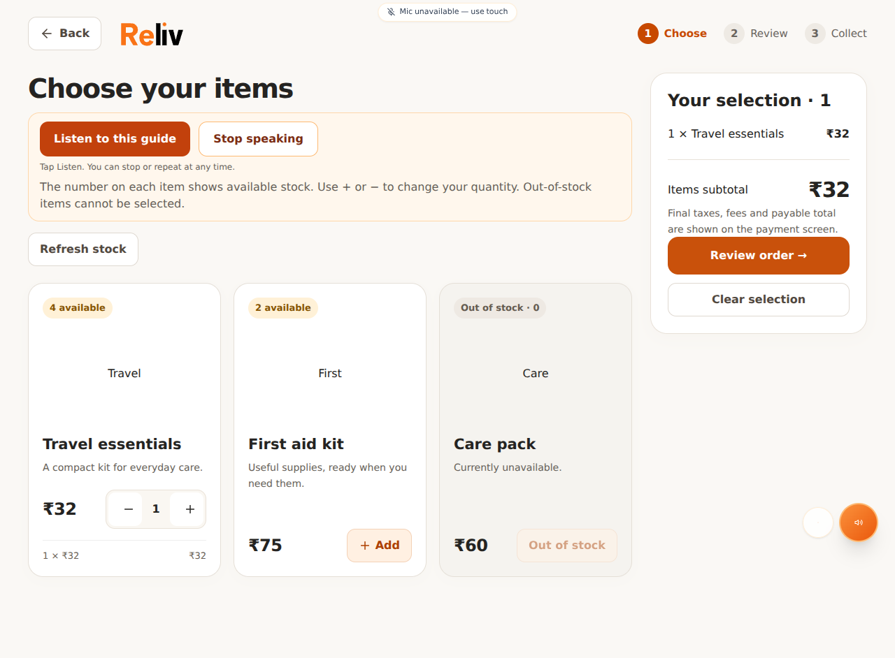
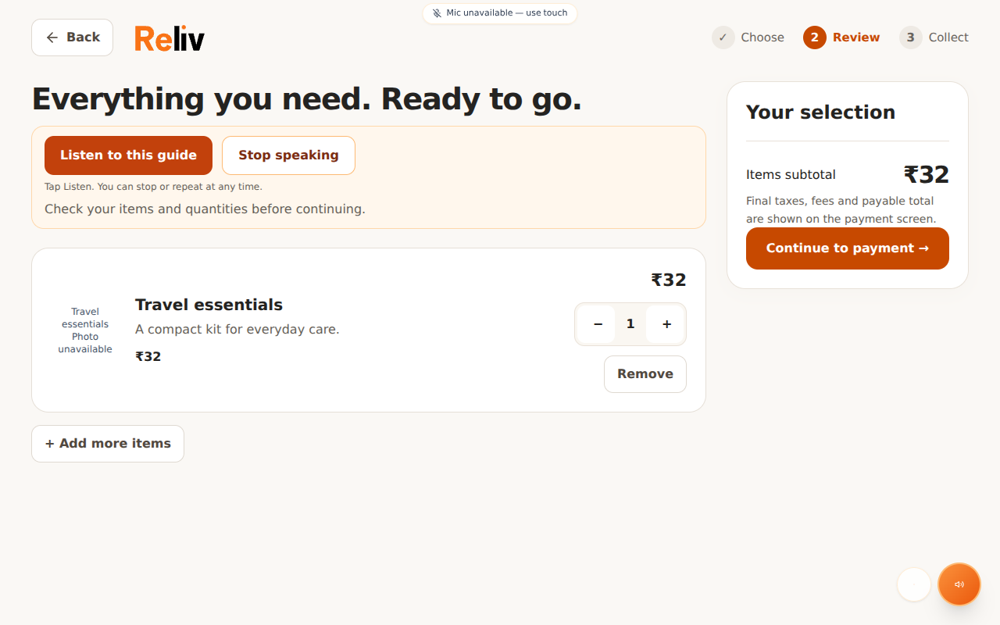
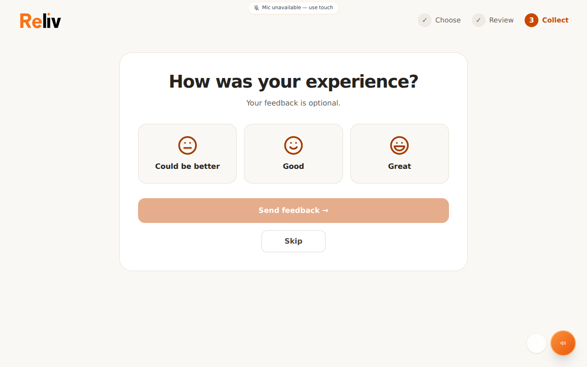

# Kiosk commerce polish

Designed for the owner's 10.1-inch 1280×800 kiosk. This PR changes presentation and the optional post-collection finish flow; it does not deploy software or activate UV hardware.

## Changes

- One local SVG wordmark shared by kiosk and customer-web, with a clear gap above the i. Splash, shared report/admin branding, health cards, and story exports use the vector artwork.
- Quiet orange/white medicine cards, readable stock badges, 48px touch controls, responsive layout and an in-flow order summary. Removed continuous sparkle and background animation from medicine selection.
- Compact checkout with item photos/fallback, quantity controls, and a clear subtotal. Removed invented comparison prices, fabricated cost breakdowns, and an optional-fee control that could not change server pricing. Final taxes/fees/payable amount remain authoritative on the payment screen.
- Delivery status keeps the backend state machine: pending/uncertain orders never become successful because of a timer or animation. Confirmed collection leads to optional feedback, then a three-second branded light sweep and Home.
- English, Hindi and Bengali finish controls. Feedback can be skipped; a failed request can be retried or skipped. SVG rating faces do not require installed emoji fonts. Feedback uses the existing backend endpoint; this PR does not add an offline feedback store or verify mail delivery.
- No fake UV-cleaning completion. The sweep is a screen transition, not evidence that any surface or medicine was sanitized.

## Validation

- Kiosk and customer-web production builds.
- Changed-component ESLint and git whitespace checks.
- 61 DOM integration assertions: stock refresh/empty stock/quantity limits, backend delivery states, local speech fallback/cancellation, checkout cart handoff, feedback failure/retry/skip and return Home.
- Chromium production-build inspection with mocked APIs at 1280×800 and 390×844: catalog, checkout, collection, feedback, reset and splash. No page exceptions and no horizontal overflow in inspected catalog/checkout screens. This is not a real payment, physical touch panel, Pi performance, speaker or motor test.

## Inventory and alerts

Backend PR #51 is merged. It reserves stock before dispatch and keeps ACK finalization/deduction idempotent. Existing `lowStockSnapshot` selects physical quantities 0, 1 and 2. The payment bridge sends plain-language refill alerts after verified payment, deduplicating the same stock revision.

These are **pre-dispense phone-carried snapshots**, not live post-dispense stock. A transition from 3 to 2 cannot reach the cloud until a later phone request relays the updated snapshot. SMTP configuration and actual inbox delivery are not verified here. Timed motor completion cannot prove medicine reached the tray without a drop sensor.

## Pi acceptance check

With no active orders, deploy the reviewed frontend build using the existing deployment procedure. Confirm backend #51 is installed. At 1280×800, run one controlled new order: select and change quantity, review the backend payable amount, pay once, collect, submit or skip feedback, observe the short reset, and return Home. Verify one stock decrement per dispensed quantity and no repeat motor action after reconnect. Check an uncertain order stays in staff review. Verify the actual speaker, touch scrolling and item photographs locally.

## Design assessment

Subjective design review: previous commerce screens about 5.5/10; this revision targets about 8.5/10 for hierarchy, branding and touch usability. A 10/10 claim needs observation of real customers on the Pi, real product photos, and validation of the operational flow.

## Twelve next improvements

1. Use real item photographs compressed as local WebP, with consistent lighting and a plain background.
2. Add a silent 6–8 second local MP4 demonstration of selecting, paying and collecting; show it only while idle.
3. Use a small illustrated tray locator when an order is ready, matched to the actual hardware position.
4. Put a physical orange marker on the collection tray that matches the screen illustration.
5. Offer a large-text mode with fewer choices per row.
6. Keep the chosen language consistent across every instruction and error.
7. Add short captions alongside spoken guidance so noisy rooms remain usable.
8. Offer an optional soft confirmation sound for deliberate actions; respect mute and avoid overlapping audio.
9. Show the current step with one clear next action, especially during payment and dispensing.
10. Add an undo action after removing an item, before payment starts.
11. Use a brief privacy reminder when leaving a health report; clear personal details when returning Home.
12. Test with five first-time users and record where they hesitate before adding more decoration or animation.

## Production-build previews (mock inventory)

